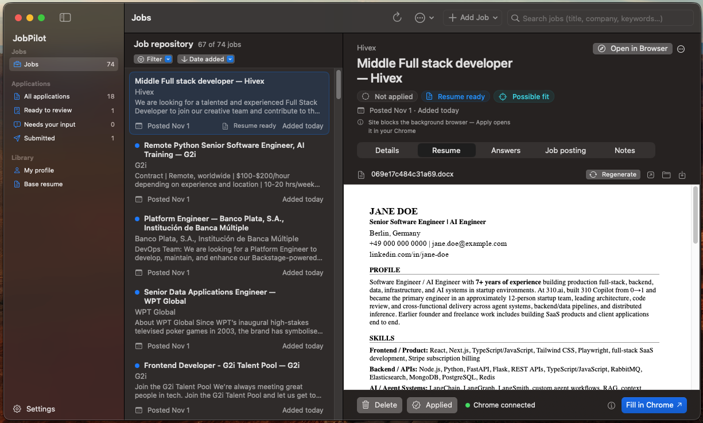

# JobPilot: AI Job Search, Resume Tailoring and Auto-Fill for macOS



**JobPilot is an open-source AI job search and application assistant for macOS.** JobPilot finds remote jobs, checks that you're actually eligible for them, tailors your resume to each posting, drafts answers to the application form, and fills the form in your own Chrome. **You review everything and press Submit yourself.**

`job search automation` · `resume tailoring` · `ATS resume optimizer` · `AI job application` · `remote jobs` · `SwiftUI macOS app` · `Playwright` · `OpenRouter` · `TypeScript`

## What it does

```
Find jobs ─▶ Verify ─▶ Check eligibility ─▶ Tailor resume ─▶ Draft answers ─▶ Fill in Chrome ─▶ You submit
```

- **Finds jobs** across Brave web search, Greenhouse / Lever / Ashby / Workable boards, Hacker News "Who is hiring", YC and funding lists, Google Jobs (optional), RemoteOK, Himalayas and Wellfound.
- **Verifies each posting**: still open, posted recently, really remote, and open to your country (structured location data first, an LLM only for unclear cases). Your own country and regions are configurable.
- **Tailors your resume** per job with a fit check and an ATS keyword-score loop. It never invents experience; it only selects and rephrases what is in your own resume files. Exports `.docx`.
- **Drafts application answers** from your profile and notes, and **learns** from the edits you make.
- **Fills the form in your own Chrome** (your logins, your session) and stops before Submit.
- **Native Mac app (SwiftUI)** with a jobs list, per-job resume and answers review, pipeline progress, and editors for your profile and resume. A CLI and a local dashboard are included too.

Your data stays on your machine. The only network calls go to the job sources you enable and to [OpenRouter](https://openrouter.ai) for the LLM steps.

## Requirements

| | |
|---|---|
| macOS 15+ | for the Mac app (the engine and CLI also run on other systems, but this is only tested on macOS) |
| Node.js 22.13+ | `node -v` |
| Google Chrome | used for filling forms and for headless page checks |
| Swift 6 / Xcode command line tools | only to build the Mac app (`xcode-select --install`) |
| [OpenRouter](https://openrouter.ai/keys) API key | all LLM steps |
| [Brave Search](https://brave.com/search/api/) API key | job discovery |

Optional: a [SerpApi](https://serpapi.com) key for the Google Jobs source.

## Quick start

**1. Install**

```bash
git clone https://github.com/pooriyapfn/Jobpilot.git
cd Jobpilot
npm install
```

**2. Create your private data folder**

JobPilot keeps your resume, answers, API keys and results outside the code, in `$JOBPILOT_HOME`. This is the same folder the Mac app uses by default.

```bash
export JOBPILOT_HOME="$HOME/Library/Application Support/JobPilot"
mkdir -p "$JOBPILOT_HOME"
cp -n .env.local.example "$JOBPILOT_HOME/.env.local"
for f in knowledge/*.example.md knowledge/resume/*.example.md; do
  d="$JOBPILOT_HOME/${f%.example.md}.md"; mkdir -p "$(dirname "$d")"; cp -n "$f" "$d"
done
```

**3. Add your keys and details**

Edit `$JOBPILOT_HOME/.env.local`:

```
OPENROUTER_API_KEY="sk-or-v1-..."
BRAVE_API_KEY="..."
CANDIDATE_COUNTRY="Germany"      # where you live: drives the eligibility filter
CANDIDATE_CITY="Berlin"
```

Then replace the placeholder text in `$JOBPILOT_HOME/knowledge/` with your own: `resume/main_resume.md` (your CV), `resume/base_resume.md` (a bank of all your experience), `profile.md`, `preferences.md`, `answers.md`.

**4. Run it**

Mac app:

```bash
npm run macos:run                 # run from source, or
./scripts/make-app.sh             # build ~/Applications/JobPilot.app, then open it like any app
```

In the app: **Find jobs** → pick a job → **Prepare** → review the resume and answers → **Apply** (opens the filled form in Chrome) → check it and submit.

Or the terminal menu:

```bash
npm start
```

Or step by step:

```bash
npm run search && npm run verify && npm run enrich   # find, verify, check eligibility
npm run prepare-jobs                                 # tailor resumes + draft answers
npm run chrome                                       # open the job-hunting Chrome; log in to sites once
npm run fill -- --limit 3                            # open filled forms; you review and submit
```

> The Mac app builds from this repo and starts the engine from it, so keep the repo where it is after `make-app.sh`. A standalone signed `.app` with bundled Node is not done yet.

## Is it safe?

- It **never submits** an application. It fills the form and leaves the tab open for you.
- It runs in **your own Chrome profile** (`~/.chrome-jobs`), so it uses your normal logins and no credentials are handed to JobPilot.
- Resume and answer text is built only from your own files. The tailoring rules forbid inventing experience, tools, or years.
- The local engine listens on `127.0.0.1` only, with a per-launch token.
- Keys and personal files (`.env.local`, `knowledge/`, `data/`) are gitignored. Only `*.example` templates are in the repo.

## Documentation

- [Reference](docs/REFERENCE.md): every command, search source, API route, config option, data folder and the project layout.
- [macOS app](apps/macos/README.md): architecture of the SwiftUI app.
- [Contracts](packages/contracts/README.md): shared types between the engine and the app.

## Project layout

```
apps/cli         interactive terminal menu
apps/macos       SwiftUI app
packages/engine  job search, resume tailor, apply agent, local HTTP API
packages/contracts  zod schemas shared with the Swift app
```

## Development

```bash
npm test               # engine + contracts tests
npm run typecheck
npm run macos:test     # Swift tests
```

Change a shared type in `packages/contracts/src`, then run `npm run contracts` to regenerate the JSON Schema and Swift types.

## Contributing

Issues and pull requests are welcome. Please run `npm test` and `npm run typecheck` before opening a PR, and never commit real personal data or keys.

## Disclaimer

JobPilot automates repetitive steps; you remain responsible for what you submit. Respect each site's terms of use and rate limits. Job-board data belongs to its owners (RemoteOK and Himalayas listings keep a link back to their source).

## License

[MIT](LICENSE)
