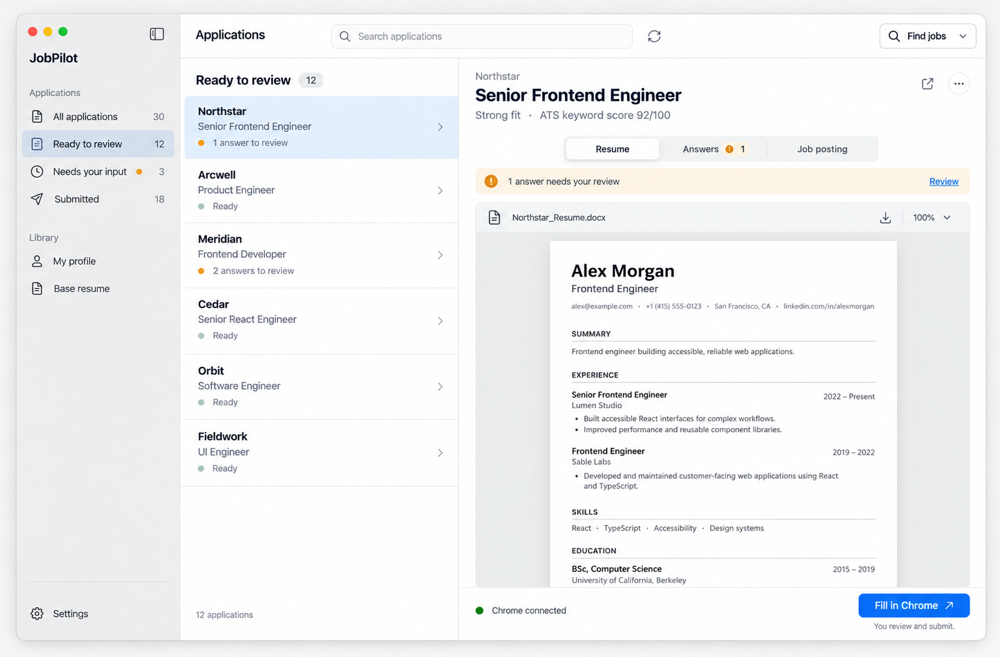

# JobPilot — native macOS UI handoff

Build the approved second UI concept in the existing SwiftUI app. The main experience is a compact application queue beside a tailored resume, with application answers one tab away.



## Start here

1. Inspect `reference.png`: this is the approved visual direction.
2. Read `BUILD_SPEC.md`: this defines behavior, implementation boundaries, and completion checks.
3. Give your coding agent `AGENT_PROMPT.md`, or paste its contents into its chat.

## Files

| File | Purpose |
| --- | --- |
| `reference.png` | Approved UI concept; primary visual reference. |
| `BUILD_SPEC.md` | Layout, interactions, existing code/API map, and acceptance criteria. |
| `AGENT_PROMPT.md` | Ready-to-paste implementation request. |
| `image-generation-prompt.txt` | Original built-in imagegen prompt, retained for design provenance. |

The screenshot is a generated concept. Company names, candidate details, counts, and scores are illustrative. Production UI must use real engine data. Written behavior in `BUILD_SPEC.md` takes precedence over incidental details in the picture or generation prompt.

## Design intent

- A small, focused Mac utility: native toolbar, sidebar, selection, and controls.
- Three panes: navigation → application list → selected application.
- The tailored resume is the main content; answers and the job posting are adjacent tabs.
- Use system colors and typography. Keep badges, borders, and decorative surfaces restrained.
- Preserve the workflow: review → fill in Chrome → user submits.

The visual inspiration was the [Dossier repository](https://github.com/AienTech/dossier), especially its [demo GIF](https://github.com/AienTech/dossier/blob/main/.github/images/demo.gif): quiet neutral surfaces, modest navigation, and document-focused application review. This handoff translates those ideas into the existing native JobPilot app. It does not request copying Dossier source code or adding its chat, cover-letter, email, or calendar features.

## Target and scope

Repo root: the `jobpilot/` directory containing this package, `package.json`, `apps/`, and `packages/`.

Target: `apps/macos`, SwiftUI, macOS 15+, Swift 6. Keep the existing TypeScript engine and generated contract boundary. This is an implementation brief; the handoff itself changes no application code.

Implement the application workspace first, then connect the visible navigation and toolbar actions to the existing profile, resume, search, and preparation capabilities. Every visible control should work or clearly explain an actual unavailable state.

## Commands

Run from the `jobpilot/` repo root:

```sh
npm run macos:run
npm run macos:test
```

If engine or contract code changes:

```sh
npm run typecheck
npm test
npm run contracts:check
```

Use `npm run contracts` to regenerate contracts when schemas change; never edit generated Swift or JSON schemas manually.
